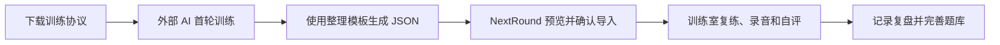
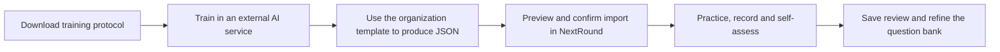

# 下一场 · NextRound

[简体中文](#readme-zh) · [English](#readme-en)

本地优先的面试训练与岗位备考工作区。 / A local-first workspace for interview practice and job preparation.

<a id="readme-zh"></a>

## 简体中文

### 用途、状态和操作示意

NextRound 帮助企业求职者及公务员、事业单位报考者把散落的岗位准备材料转化为可关联、可追溯、可反复练习的本地资料。AI 在用户选择的外部服务中完成首轮训练与整理，应用本身不调用模型，也不自动上传简历。是否向外部 AI 提供 JD、简历或回答由您决定；请先匿名化，并了解所选服务的数据政策。本地保存不能保证主动交给外部 AI 的内容仍在本机。

当前版本为 **1.0.1**（首发为1.0.0），源码已公开，正式站点已上线。下面说明的功能以现有实现为准；未实现内置 AI／Agent／RAG、账号、云同步／远程数据库、订阅支付或独立熟练度算法／间隔复习（SRS）。现有训练历史、时长、自评和难度筛选不等于自动熟练度管理。界面目前以简体中文为主，本文件提供完整中英双语说明。



首次打开默认展示天堂版（开灯）；之后沿用您手动选择并保存的应用主题。加载页始终使用暗底＋绿色，不区分亮暗主题。

### 无私人信息的快速体验

1. 首先启动应用并进入「体验演示档案」，无需真实简历或面试信息。
2. 下载完全虚构的[示例 JSON](examples/interview-prep.json)，并阅读[来源 Markdown 与导入说明](examples/interview-prep.md)。示例不代表真实人物、公司、岗位或面试反馈。
3. 在「知识库 → 导入」选择 JSON，检查预览中的模块、条目、错误和冲突后确认；到训练室按分类或天堂／人间／地狱难度抽题。
4. 相同内容重复导入应去重；同 ID 不同内容应按冲突处理，不用「替换导入完整备份」导入统一 JSON。统一 JSON 当前上限为 10 MB／10000 条，该上限不泛化为所有完整备份限制。

纯本地、离线优先的面试训练与岗位备考工作区，支持企业求职、公务员及事业单位招录。业务记录保存在当前浏览器的 IndexedDB；应用无账号、后端、云同步或运行时 AI API。

## 启动与档案空间

需要 Node.js 20 或以上。应用运行时无第三方依赖，无需 `npm install`。

```powershell
cd NextRound
npm start
```

开发时打开 [http://localhost:4173](http://localhost:4173)。请固定使用此地址与端口；浏览器按来源隔离数据，`localhost` 与 `127.0.0.1` 是两份存储。静态服务器仅监听本机，不接收或保存个人业务数据。

新正式档案为空白，点击「体验演示档案」才进入独立示例。正式库为 `nextround-local`，演示库为 `nextround-demo`；URL 的 `?space=demo` 保持演示选择，刷新后仍在相同空间。演示中的修改只写入演示库，返回正式档案可继续原记录。

## 日常使用

1. **准备控制台**：周历可左右换周，日程列表独立上下滚动并定位今天，过往在上、未来在下。已有面试按约定时间出现；可新增普通日程、训练及面试准备，关联单位、面试或知识库。普通日程可勾选完成；已完成面试的勾选锁定。日程须点击「保存日程」写入当前档案。
2. **岗位档案**：关联公司或招录单位，整理招聘材料、标签和进展，可手动新增或导入 V4/统一 JSON。企业记录 JD、薪资与 Offer；公招记录招录项目、职位代码、资格、原始成绩及流程。
3. **知识库**：整理面试题、自我/项目介绍与内容卡片。新题难度为「天堂 / 人间 / 地狱」；历史「易 / 中 / 难」兼容读取，不会因加载静默改写。题目保留回答历史，介绍稿仅保留当前正文与分段。
4. **训练室**：选择单位、岗位、题型、难度和标签，抽题、正计时/倒计时、本地录音与回放，结束后记录自评。自我/项目介绍可使用底稿，也可在没有岗位、题目或介绍稿时自由表达。初始化与空间切换共用完整训练状态，已保存的录音草稿可继续使用。
5. **面试档案**：保存多轮面试、现场问题与回答、优化回答、反馈及附件；按问题 ID 或完全相同原文并入题库。
6. **成长分析**：按单位、岗位、起始日期筛选问题频率、题库关联命中率、关键词覆盖及训练时间，点击追溯原始记录。
7. **决策中心**：企业比较个人意向、招聘规则分、年包与时薪；公务员及事业单位比较报考意向、原始成绩和招录流程。公招成绩、排名及资格由本人记录，不自动换算或推断入围、录用；流程规则分不等于实际成绩或录用概率，自评和反馈不为公招流程分加减分。

顶栏搜索或 `/` 快捷键可跨模块搜索。有效记录在填完必填项后自动保存，顶栏持续显示当前空间及实际保存状态。旧面试记录的「待面试」兼容为「待确认」，岗位流程阶段的「待面试」保留。

### 内容卡片与稿件

在「知识库 → 内容卡片」分别整理开场、经历、收尾及长短版素材，再在题目或介绍稿编辑器中拖入或点击添加。分段可独立编辑、排序和移除；手机有按钮替代拖动。素材以加入时的内容副本保存，之后修改或删除素材不会改变已保存稿件。

直接编辑全文会清空当前分段并保留手写内容；再次加入卡片时继续保留原文。分段删除可在当前编辑器撤回，关闭编辑器后撤回记录释放，不生成持久的介绍稿历史版本。题库回答历史继续保留。

卡片库和拼接面板的类别、版本及自定义标签均可筛选。长按标签约 350ms 可拖动优先级，键盘使用 Alt + 左右方向键；顺序写入当前空间设置并参与备份，暂时无卡片的标签顺序不会主动删除。

### 从空题库开始与 AI 协作

空题库默认展开「从零开始，建立您的专属面试题库」四步指南：下载训练协议，在您选择的 AI 中完成首轮训练，再用整理模板生成 JSON，导入后回到训练室复练。各步骤收起时仅显示标题，原有简介与详细操作保留在展开内容中。两条指令通过框右侧的 LED 图标复制全文；下载按钮旁的信息图标说明用途和设置位置，支持点击、键盘聚焦与悬停。文件格式小提示独立成框，收起整份指南后仍保留。

是否为空依据完整的 `state.questions`，搜索零匹配不会触发空题库引导。已有题目或导入成功后指南默认收起，仍可手动展开。

「设置 → 使用 AI 协作」集中放置 [通用 AI 面试训练协议](assets/通用AI面试训练协议_公开版_V1.0.md)、[AI 整理模板 V1.4](assets/NextRound_AI整理与一键导入通用模板_V1.4_面试题三级难度.md) 与「导入 JSON」。下载资料保留用户源文件字节；文中面向 AI 的指令只作为文件内容，不是应用的运行规则。AI 训练与整理在用户选择的外部 AI 对话中进行，应用只在本机预览和导入 JSON。

统一导入与完整备份分开：统一导入先预览模块、条目和冲突，再确认写入；空数组不会清空本机记录。备份仍使用独立的导出、增量导入和替换导入入口。

## 档案、备份与删除

- 两个空间分别使用 IndexedDB 原子保存、独立写队列和版本检查。其他窗口更新后，旧窗口不能覆盖新记录；请先导出旧窗口，再刷新并增量导入。
- 完整备份是未加密的 JSON，包含记录、设置、录音、附件、冲突及垃圾箱。请确认下载完成，并把文件保管在浏览器之外。清除站点数据、浏览器回收存储或结束隐私模式可能使档案不可用；换浏览器、设备或来源不会自动迁移，须使用导出/导入。
- 备份标注正式/演示空间，跨空间拒绝写入。当前空间先校验结构、类型与引用；增量导入按稳定 ID 合并，相同内容去重，不同内容保留本机并保存导入候选快照。重复导入不会重复建立相同冲突。
- 采用导入冲突版本时仍保留原本机快照。替换导入须完整校验，确认后替换该空间全部记录、附件、设置、冲突和垃圾箱；取消不写入，建议先导出备份。
- 旧混合恢复包直接清除，不提供下载或恢复入口；此前已迁移的正式个人记录保留。尚未迁移的旧状态保守移出无关联的固定示例，保留个人记录与必要关联，不再保存混合快照。
- 「申请持久存储」由浏览器决定是否批准，可降低空间不足时被自动清理的风险；它不提供云备份，手动清除网站数据仍会删除档案。备份提醒每 7 天触发。

导入、导出、附件、麦克风权限等待和清空等异步操作使用独占任务锁，捕获开始时的空间与状态并在异步继续前核对。附件始终关联开始上传时的面试 ID；文件操作期间阻止切换空间和重叠操作。

### 垃圾箱与清空当前档案

记录列表或编辑器可「移入垃圾箱」。删除单位/岗位会连同关联记录打包，录音与附件随记录保留；仍被使用的题目或介绍稿须先解除关联。恢复遇到同 ID 不同内容时拒绝覆盖。两个空间的垃圾箱独立，并参与完整备份。

在「设置 → 数据管理与备份」的工具区，「垃圾箱（数量）」与「安装到设备」同行，垃圾箱排在最后；持久存储单列。垃圾箱对话框标题旁的 LED 图标只清空当前垃圾箱，关闭按钮在右上。

同一区域的「清空当前档案」是独立危险操作：确认后彻底删除当前空间的全部记录、录音、附件、设置、冲突与垃圾箱；取消不写入，另一空间不受影响。训练或录音尚未结束时不能执行。全局灯光偏好不随档案清空。

## 首页、主题与声音

首页保留古典神秘主义海报、独立加载页和双入口：Interview 可进入面试工作区，Ritual 灰色禁用并显示「建设中，敬请期待」。开灯使用冷白石材、浅银金属天使与象牙旧金配色，格言为 `Invenies Occultum Lapidem`；关灯使用用户指定造型的机械堕天使、黑铬与深绿反光，格言为 `Solve et Coagula`。工作区相应使用象牙石面或黑色/亮绿系统，两套均保留细颗粒。

环境、两套雕像、巫师、光门、头环与水面阴影独立分层。两尊雕像按真实眼部点配准；眼部坐标与头环中心是不同的定位依据。原图轮廓、历史候选及旧阶段坐标不能代替现役素材和最终配准证据，详见 [素材清单](docs/ASSETS.md) 与 [视觉系统](DESIGN.md)。

鼠标与手机重力以不同小幅深度带动环境、完整主体组、文字和入口卡；巫师随主体组移动。关闭动效、减少动态、隐藏页面或离开首页会归零。需传感器权限的平台通过首页动效按钮主动申请，拒绝后保持静态；手机重力已做模拟验证，尚未真机验收。

声音默认关闭。首次点击声音按钮后，`paired-bgm.js` 使用本地 `hermetic-geometry-heaven.mp3` 与 `hermetic-geometry-hell.mp3`，两首原速、同一时钟起播并共用循环边界。切灯仅交叉调整音量，约 1.2 秒完成；快速反向切换从当前增益继续，不重置进度。已测解码尾差约 50ms，只在较短曲的内存尾部补静音，不裁切或变速。录音、附件播放、页面隐藏时冻结共同播放时钟，恢复后继续；路由切换不重播。加载中再次点击静音也能立即取消播放意图。

首页右上灯光按钮在最左，并保留分享；工作区左下依次为开关灯、分享、设置、返回，前两项沿用 9×9 LED 点阵，右上不重复分享。手机点击缩略 Brothforge Logo 先展开导航，再次点击完整品牌进入 [Brothforge](https://www.brothforge.com/#relic)；点击导航、遮罩或 Escape 收起。左下原版版权、AI、规则与联系页脚保留，正文有避让。

## 离线、录音与加载

首次在线打开并等待 Service Worker 完整缓存后，可断网刷新。页面 CSS、JS、字体、图标、两首音乐、现役场景及下载协议/模板均为本地资源，不依赖 CDN。缓存版本和清单以 `sw.js` 为准；缓存标识用于资源更新，不等于应用或数据 Schema 版本。

Chrome / Edge 可从地址栏、浏览器菜单或设置页安装；iOS Safari 使用「分享 → 添加到主屏幕」。安装条件与持久存储由浏览器决定。PC 和手机的 localhost 各自指向本机；手机独立使用需把静态文件放在手机可访问的 HTTPS 来源。未完成真实手机或系统安装点击验收。

录音须浏览器麦克风授权，拒绝不影响其他功能。单个附件最大 30 MB，配额不足会显示保存失败。强制关闭浏览器前尚未结束的录音不保证恢复；停止并保存的录音可恢复为训练草稿。已保存录音与附件参与完整备份。

加载页使用 `#101010` 底色、圆门标志、2.5 秒呼吸、240px × 2px 进度线和 500ms 退场。进度对应模块就绪、档案读取、首屏图片解码与字体准备，不模拟下载字节或设置最低等待时长。档案未打开时不能跳过；画面资源失败可重试或先进入。减少动态或关闭动效时直接退场，完成后释放首屏交互。

## 发布前准备

运行 `npm run build`，只将输出的 `dist/nextround-public-<时间>/` 目录作为静态托管根目录。打包依据 `sw.js` 的运行资源清单，并附字体许可证；不包含文档、测试、维护截图、Git 数据或历史候选。不要直接公开整个源码仓库。发布包必须通过 HTTPS 提供，才能使用离线安装和麦克风能力。

源码开源使用 `npm run build:source` 生成的独立目录，保留源码、构建脚本、现役测试和许可。候选图、历史截图、机器路径与一次性交接脚本保留本地，不随公开源码交付。完整边界见 [开源交付](docs/OPEN-SOURCE.md)。

## 维护入口与验证

| 文件 | 职责 |
| --- | --- |
| `app.js`、`settings-ui.js`、`knowledge-guide.js` | 路由、训练状态工厂、业务交互、设置与四步指南 |
| `core.js`、`db.js`、`workspaces.js`、`trash.js` | 校验、事务、版本、空间与备份/垃圾箱边界 |
| `opportunity.js`、`opportunity-ui.js` | 企业、公务员、事业单位的字段、流程与比较 |
| `content-cards.js`、`card-tags.js`、`script-history.js`、`knowledge-ui.js/css` | 内容拼接、标签优先级、介绍稿历史清理与编辑 UI |
| `style.css`、`poster.css`、`shell-ui.js/css`、`icons.js`、`ui-standards.css` | 基础界面、海报、品牌壳与 LED 图标 |
| `duality.css`、`review-ui.css`、`chrome-review.css` | 两主题场景、指南/设置精修及常驻控件最终覆盖，按此顺序加载 |
| `corner-ui.js/css`、`paired-bgm.js`、`portal-motion.js` | 常驻控件、双曲音频与鼠标/重力响应 |
| `startup.js/css`、`sw.js`、`manifest.webmanifest`、`server.mjs` | 加载、离线安装与仅本机监听的静态服务器 |

```powershell
npm run check
npm test
```

界面规范依据、项目中的应用及人工验证边界见 [前端规范](docs/UI-STANDARDS.md)。

浏览器测试依赖仅用于开发，不进入应用运行时。安装与执行见 [测试说明](docs/TESTING.md)，验证范围见 [UI 与离线验证](docs/UI-VERIFICATION.md)。历史阶段截图与报告保留本地，不作为当前可复跑入口。

```sh
npm ci
npx playwright install chromium
npm run test:browser
npm run build:source
```

数据机制见 [DATA-MODEL](docs/DATA-MODEL.md)，产品边界见 [PRODUCT](PRODUCT.md)，视觉系统见 [DESIGN](DESIGN.md)，素材来源与许可见 [ASSETS](docs/ASSETS.md)。

## 许可

代码和本项目编写的说明文档采用 [MIT](LICENSE)，版权主体为 Brothforge。插画、BGM 和品牌素材按 [独立素材条款](ASSET-LICENSE.md) 授权：允许随 NextRound 运行、展示和再分发，未默认授权挪用于其他项目；第三方字体保留各自许可证，详见 [第三方说明](THIRD-PARTY-NOTICES.md)。下载协议和模板中的原有使用说明保留。

## 已知限制、版本与公开反馈

- 当前证据来自内部自动化和有限人工检查，尚无可引用的大样本用户效果、留存或面试成功率结论。自动无障碍扫描零违规不等于完整 WCAG 认证。
- 没有内置 AI；外部模型可用性、费用、输出质量和数据政策由对应服务决定。导入校验不证明生成事实或训练评分正确。
- 没有账号、云同步、跨设备自动迁移或独立 SRS。请自行保管完整备份，不把浏览器存储当唯一备份。
- 真实手机传感器、真实麦克风／真人听感、系统安装确认、存储配额耗尽仍需目标环境验证；生产 HTTPS 和基础响应头已检查。
- 正式站点为 [https://nextround.apps.brothforge.com/](https://nextround.apps.brothforge.com/)，DNS、HTTPS、资源完整性及关键浏览器链路已验证，详见[首发记录](docs/releases/v1.0.0.md)。公开源码仓库为 [33smeowtastic/NextRound](https://github.com/33smeowtastic/NextRound)。

| 标识 | 含义 |
| --- | --- |
| 应用 `1.0.1` | 来自 `package.json`；SEO验证补丁，对应 Tag `v1.0.1`，首发记录 `v1.0.0` 保留。 |
| 本地状态 `schemaVersion: 1` | 当前本地档案及完整备份中的状态结构。 |
| 统一导入 `next-round-unified-1.2` | 当前模板契约；解析器也兼容 1.0／1.1。模板的 `version: "4.0.1"` 是 V4 来源格式，不是应用版本。 |
| 离线 `CACHE` | 由 `sw.js` 定义，仅更新资源缓存，不是数据迁移版本。 |
| 构建目录与 manifest | UTC 时间标记产物；清单记录相对路径、大小和 hash。 |

更新记录见 [CHANGELOG](CHANGELOG.md)，发布材料见 [Release Notes](RELEASE-NOTES.md)。搜索和 AI 检索开放、限制模型训练爬虫的配置与上线后检查见 [SEO 说明](docs/SEO.md)；不保证所有爬虫遵守规则，不承诺收录或 AI 引用。

发布流程：公开仓库为 [33smeowtastic/NextRound](https://github.com/33smeowtastic/NextRound)；后续版本在对应版本分支开发、构建并上线验证，确认无问题后再合并到 GitHub `main`。Tag、Release 与最终验证通过的版本提交保持一致。本次首发 `main` 与 `codex/release-v1.0.0` 使用同一提交；后续版本才执行线上验收后合并，详见[部署说明](docs/DEPLOYMENT.md)。

请在公开仓库的 [Issues](https://github.com/33smeowtastic/NextRound/issues/new/choose) 页使用 [Bug Report](.github/ISSUE_TEMPLATE/bug_report.yml) 或 [Feature Request](.github/ISSUE_TEMPLATE/feature_request.yml)。说明复现步骤、预期／实际结果、版本及浏览器环境。**不要公开上传真实简历、联系方式、面试原文、完整备份、录音或未脱敏截图／日志。** 请优先使用虚构示例或最小合成资料复现。

[切换到 English](#readme-en)

---

<a id="readme-en"></a>

## English

### Purpose, status and workflow

NextRound is a frontend-only, local-first workspace for enterprise job seekers and applicants to civil-service/public-institution recruitment. It brings job preparation, questions, introduction scripts, practice recordings, interview reviews and decision evidence into linked, traceable material for repeated practice. Business records live in the current browser's IndexedDB. There are no accounts, backend, cloud synchronization or runtime AI API.

Initial AI training and content organization take place in an external service chosen by the user. NextRound validates and previews structured imports, supports practice and keeps local records; it does not call a model or automatically upload résumés. You decide whether to provide a résumé, job description or answer to an external AI. Anonymize materials and check that provider's data policy; local storage does not keep material local after you deliberately send it elsewhere.

The current version is **1.0.1** (initial release: 1.0.0). Source is public and the production site is online. The interface is primarily Simplified Chinese, while this README contains complete Chinese and English instructions. Built-in AI/agents/RAG, accounts, cloud services, subscriptions/payments and an independent mastery/spaced-repetition system (SRS) are not implemented. Current difficulty filters, practice history, duration and self-assessment are not automatic mastery management.



### Start locally and choose a space

Use **Node.js 20 or later** and a modern browser. The application has no third-party runtime dependencies, so starting it does not require `npm install`.

```sh
cd NextRound
npm start
```

For development, open [http://localhost:4173](http://localhost:4173). Keep the same host, protocol and port: browser storage is origin-specific, so switching origins does not move the original archive. The static development server listens only on the local machine and does not receive or store personal business records.

A new formal archive is empty. Select “体验演示档案” (Try demo archive) to enter separate sample data. The formal database is `nextround-local`, the demo database is `nextround-demo`, and `?space=demo` preserves the demo selection. Demo writes stay in their own database; returning to the formal space restores access to its original records.

### Available modules

1. **Preparation dashboard:** weekly calendar and an independently scrolling schedule; link ordinary tasks, training and interview preparation to organizations, interviews or knowledge items. Ordinary tasks can be completed; completed interviews are locked. Use “保存日程” (Save schedule) to persist schedule edits.
2. **Job records:** organizations, job descriptions, materials, tags and progress, with manual entry, V4 and unified JSON import. Enterprise roles include salary and offers; public recruitment includes project/position codes, eligibility, raw results and process stages.
3. **Knowledge library:** categorized questions and answers, Heaven / Earth / Hell difficulty, self/project introduction scripts and content cards. Question answers retain history; introductions retain current text and sections.
4. **Practice room:** draw questions by organization, job, category, difficulty and tags; count-up/countdown timers, local recording/playback and self-assessment. Introduction practice can use a script or run freely with no job, question bank or script; saved recording drafts can be resumed.
5. **Interview archive:** multiple rounds, actual questions/answers, improved answers, feedback and attachments; merge questions into the library by ID or identical source text.
6. **Growth analysis:** filter by organization, job and date; inspect question frequency, linked-question matches, mechanical keyword coverage and practice time, with traceability to source records.
7. **Decision center:** compare personal preference, recruitment rule scores, annual compensation and estimated hourly pay for enterprise roles; compare intent, raw scores and process stages for public recruitment. Scores/ranks are recorded by the user, not inferred as admission or hiring outcomes. Rule scores are not hiring probabilities; self-assessment does not alter public-recruitment process scores.

Top search or `/` finds items across modules. Valid records autosave after required fields are completed; the header shows the current space and actual save state. Legacy easy/medium/hard question labels remain readable. Legacy “awaiting interview” interview records are interpreted as “awaiting confirmation”; the job-pipeline stage remains unchanged.

### AI collaboration and a fictional first import

The empty-library guide has four steps: download the [general AI interview protocol](assets/通用AI面试训练协议_公开版_V1.0.md), train in your chosen external AI, give the same conversation the [organization template V1.4](assets/NextRound_AI整理与一键导入通用模板_V1.4_面试题三级难度.md) to produce a plain JSON file, and import it before practicing locally. Both downloads and the import action are also under “设置 → 使用 AI 协作” (Settings → AI collaboration). Check experiences, numbers and references yourself; generated text is not verified fact.

The guide opens by default only when the entire question bank is empty; an empty search result does not trigger it. It collapses after questions exist or an import succeeds, and can be reopened manually. Collapsed steps show their titles; copy buttons copy complete instructions and adjacent help explains the downloads. Downloaded protocol/template bytes are preserved. Their AI instructions are document content, not code executed by the app.

To try the workflow without personal information:

1. Start the app and enter the demo archive.
2. Download the fully fictional [example JSON](examples/interview-prep.json) and read its [source Markdown and import steps](examples/interview-prep.md). It represents no real person, organization, job or interview feedback.
3. Select “知识库 → 导入” (Knowledge library → Import), inspect items, errors and conflicts, and confirm. Then draw questions by category or Heaven/Earth/Hell difficulty in the practice room.
4. Identical repeated imports are deduplicated. Different content under the same ID uses conflict handling. Empty module arrays do not clear existing records. Unified imports and full backups use separate entry points; do not use backup replacement for this example. Unified JSON has a 10 MB / 10,000-record limit; this does not establish the limit for every complete backup.

### Content cards and scripts

Organize opening, experience and closing material plus short/long variants under “知识库 → 内容卡片” (Knowledge library → Content cards). Drag or click to add a card to an answer or script; mobile buttons replace dragging. Sections can be edited, reordered and removed independently. Adding a card stores a content copy, so later edits/deletion of its source do not change saved scripts.

Editing the full text clears current sections while retaining the handwritten text. Adding another card keeps that text. Section deletion can be undone within the current editor; that temporary undo record is released when it closes, without persistent introduction-script history. Question-answer history is retained.

Filter the library/composition panel by category, variant and custom tags. Long-press a tag for about 350ms to drag priority, or use Alt + Left/Right. The order belongs to the current space and is included in backups; unused tag ordering is not automatically removed.

### Local data, backup, recovery and deletion

- Records, recordings and attachments are stored in **IndexedDB for the current browser origin**; some theme, sound and motion preferences use local browser storage. No background business-data upload, analytics or error-reporting service is configured, and runtime resources are local rather than CDN dependencies. Initial resource requests, browser update checks and external links you deliberately follow can still use the network.
- Clearing site data, storage eviction, private-browsing termination, changing devices/browsers or changing the origin can make an archive unavailable. Browser storage must not be the only backup. Persistent-storage permission is browser-controlled and cannot protect against deliberate site-data deletion. Backup reminders occur every seven days.
- Export a complete backup under “设置 → 数据管理与备份” (Settings → Data management and backup). Confirm the download and keep it outside the browser. It is **unencrypted JSON** containing records, settings, recordings, attachments, conflicts and trash, and may be highly sensitive. Keep it private; never upload a complete backup to public Issues or a repository.
- Restore within the matching formal/demo space. Cross-space backups are rejected. Incremental import retains local records, deduplicates identical content and stores differing versions as conflicts; accepting an imported conflict still keeps the old local snapshot. Repeated imports do not keep adding the same conflict.
- **Replacement import** requires complete validation and confirmation; it replaces all records, attachments, settings, conflicts and trash in the current space. Cancellation writes nothing. Export a backup first. Atomic writes and cross-window version checks prevent stale windows from silently overwriting newer data.
- Moving records to the current space's trash retains restoration options. Deleting an organization/job packages linked records and attachments; referenced questions/scripts must first be unlinked. Restoration refuses to overwrite different content under an existing ID. Each space has independent trash included in its backup.
- **Empty trash** and **Clear current archive** are different operations. Clearing the archive permanently deletes the current space's records, recordings, attachments, settings, conflicts and trash after confirmation; the other space and global theme preference are unchanged. Active training/recording blocks this action.
- Import, export, attachments, microphone waits, training completion and archive clearing use exclusive tasks and space/state checks. Attachments remain linked to the interview captured when upload began. Legacy mixed recovery packages are retired; previously migrated personal records remain preserved.

See the [data model](docs/DATA-MODEL.md) for storage, concurrency and compatibility boundaries.

### Home scene, themes and sound

The home scene keeps independent environment, angel/fallen-angel, wizard, portal, halo and contact-shadow layers. Visible eye landmarks register the statues; the eye point is not the halo center. Light uses ivory, silver and antique gold with `Invenies Occultum Lapidem`; dark uses black chrome and green with `Solve et Coagula`. Interview opens the workspace; Ritual remains explicitly under construction. See [DESIGN](DESIGN.md) and [assets](docs/ASSETS.md).

Small pointer/gravity offsets move the layers. Disabling motion, requesting reduced motion, hiding the page or leaving home resets them. Sensor permission is requested by user action where needed; refusal keeps the scene static. Real-phone gravity has not yet been verified. Brothforge branding/footer/links are retained; mobile navigation opens from the brand button and closes through a navigation item, overlay or Escape.

Sound is off by default. Once enabled, the two local BGM tracks play at native speed on one clock with a shared loop boundary. Theme changes crossfade gains for about 1.2 seconds, without restarting or changing speed; rapid reversals continue from current gains. The shorter decoded track receives only in-memory silence at its tail. Recording, attachment playback and a hidden page pause/resume the shared timeline. Route changes do not restart it, and muting during loading cancels pending playback.

### Offline use, recording and installation

Offline refresh requires an initial online visit and complete Service Worker caching. CSS, JavaScript, fonts, icons, BGM, current scenes and protocol/template downloads are local resources. `FILES`/`CACHE` in [sw.js](sw.js) define cache contents and identity; a cache name is not an application or data-schema version.

Browsers provide installation; iOS Safari can use Share → Add to Home Screen. Another device needs a reachable HTTPS origin; a desktop development address is not automatically a mobile entry point. Installation/persistent-storage permission depends on the browser, and real-device/OS installation remains unverified.

The microphone requires user permission; refusal leaves other features available. Each attachment is limited to 30 MB. Quota errors are reported as save failures. Unfinished recordings are not guaranteed to survive forced browser closure; stopped and saved drafts can be restored and included in complete backups.

The loading screen uses a dark surface, ring mark, breathing motion, progress line and exit transition. Progress reflects module, archive, first-screen image and font readiness rather than simulated byte counts or a mandatory minimum wait. It cannot skip archive opening; failed visual resources can be retried or bypassed. Reduced/disabled motion skips the exit animation and restores normal interaction.

### Development, tests and builds

Install dependencies only for development checks. Playwright and automated accessibility-checking dependencies do not enter the application runtime.

```sh
npm ci
npx playwright install chromium
npm run check
npm test
npm run test:browser
npm run build
npm run build:source
```

The browser runner chooses a free local port, starts the app, creates disposable contexts, runs current suites and stops the server it started. Results go to ignored `test-results/`. See [testing](docs/TESTING.md), [UI standards](docs/UI-STANDARDS.md) and [UI/offline verification](docs/UI-VERIFICATION.md). Historic test counts are not current results. Zero automated accessibility violations are not full WCAG certification.

- `npm run build` creates `dist/nextround-public-<UTC timestamp>/` for static HTTPS hosting. Deploy only that directory.
- `npm run build:source` creates `dist/nextround-source-<UTC timestamp>/` containing editable code, scripts, current tests, docs, examples and licenses.

Builds use allowlists and fresh directories, refusing an existing target to avoid stale private files. Originals, candidates, historical screenshots, machine scripts and test output remain local to the maintainer. See [source delivery](docs/OPEN-SOURCE.md). A source package is not a runtime package: do not expose the complete repository as a website.

The production site is [https://nextround.apps.brothforge.com/](https://nextround.apps.brothforge.com/). DNS, HTTPS, resource integrity and core browser flows have been verified; see the [initial release record](docs/releases/v1.0.0.md). Search/AI-retrieval access and restrictions on model-training crawlers are described in [SEO preparation](docs/SEO.md). Crawler rules are not guaranteed to be honored and do not promise indexing or AI citations.

The first visit defaults to Heaven (lights on). Later visits retain your saved application theme. The loading screen always uses a dark background with green accents, independently of that theme.

### Versions and release state

| Identifier | Meaning |
| --- | --- |
| Application `1.0.1` | From `package.json`; the SEO-verification patch uses tag `v1.0.1`. The initial `v1.0.0` is preserved. |
| Local `schemaVersion: 1` | The structure of local state and state inside full backups. |
| Unified import `next-round-unified-1.2` | The current template contract; parser support also includes 1.0/1.1. Template `version: "4.0.1"` identifies V4 source format, not the application release. |
| Offline `CACHE` | Defined by `sw.js` for resource updates, not data migration. |
| Build directory/manifests | UTC timestamps identify artifacts; manifests contain relative paths, sizes and hashes. |

See [CHANGELOG](CHANGELOG.md) and the [Release Notes](RELEASE-NOTES.md).

Release workflow: the public repository is [33smeowtastic/NextRound](https://github.com/33smeowtastic/NextRound). For subsequent versions, develop, build and deploy from the corresponding version branch; merge into GitHub `main` after validation succeeds. Tags and Releases must match the validated version commit. The initial `main` and `codex/release-v1.0.0` identify the same release commit; subsequent versions merge after live validation. See [deployment](docs/DEPLOYMENT.md).

### Known limits and feedback

Current evidence comes from internal automation and limited manual checks, not a large-sample study of user outcomes, retention or interview success. External model availability, cost, output quality and data policies belong to the selected service. Import validation does not prove factual correctness or training quality. Accounts, cloud sync, automatic cross-device migration and independent SRS are absent. Keep your own backups; the UI is currently primarily Simplified Chinese.

Real-phone sensors, real microphones/listening, OS installation confirmation and storage-quota exhaustion still require target-environment checks. Production HTTPS and basic response headers have been checked. The repository is [33smeowtastic/NextRound](https://github.com/33smeowtastic/NextRound).

Use the repository's [Issues](https://github.com/33smeowtastic/NextRound/issues/new/choose) page and its [Bug Report](.github/ISSUE_TEMPLATE/bug_report.yml) or [Feature Request](.github/ISSUE_TEMPLATE/feature_request.yml) form. Include reproduction steps, expected/actual behavior, application version and browser environment. **Do not upload real résumés, contact details, interview transcripts, full backups, recordings or unredacted screenshots/logs.** Prefer the fictional sample or minimal synthetic data.

### Documentation and licenses

See [PRODUCT](PRODUCT.md) for scope, [DESIGN](DESIGN.md) for visual rules, the [data model](docs/DATA-MODEL.md) for technical details and [source delivery](docs/OPEN-SOURCE.md) for public contents.

Code and project-authored docs use the [MIT license](LICENSE), copyright Brothforge. Illustrations, BGM and branding use the [independent asset terms](ASSET-LICENSE.md): they may run, display and redistribute with NextRound, without default permission for unrelated projects. Fonts retain their own licenses; see [third-party notices](THIRD-PARTY-NOTICES.md). Downloaded protocols/templates retain original bytes and usage statements.

[返回简体中文](#readme-zh)
